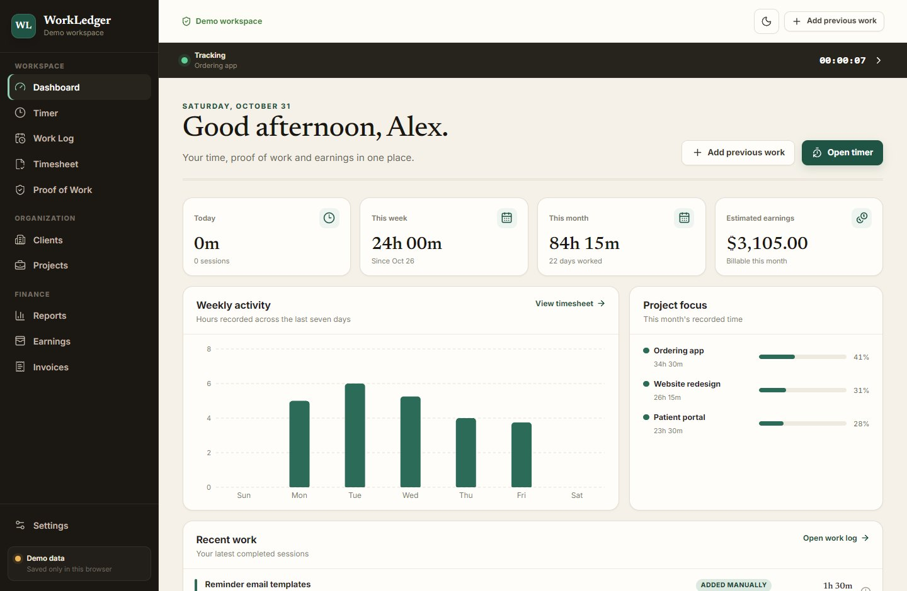
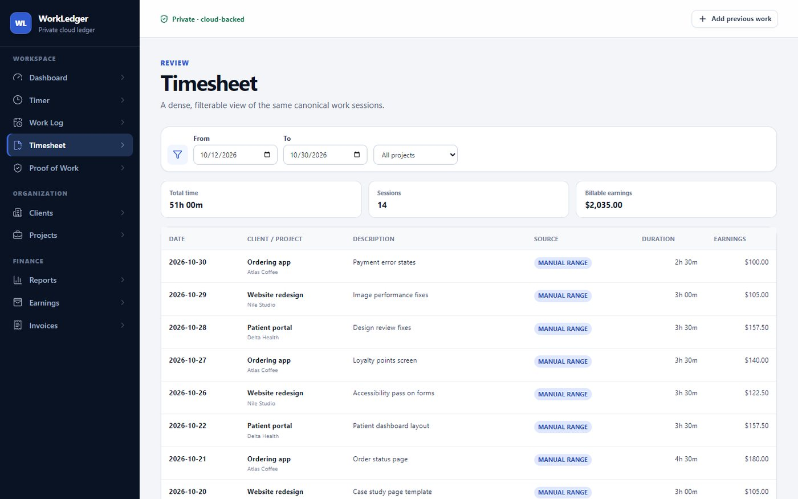
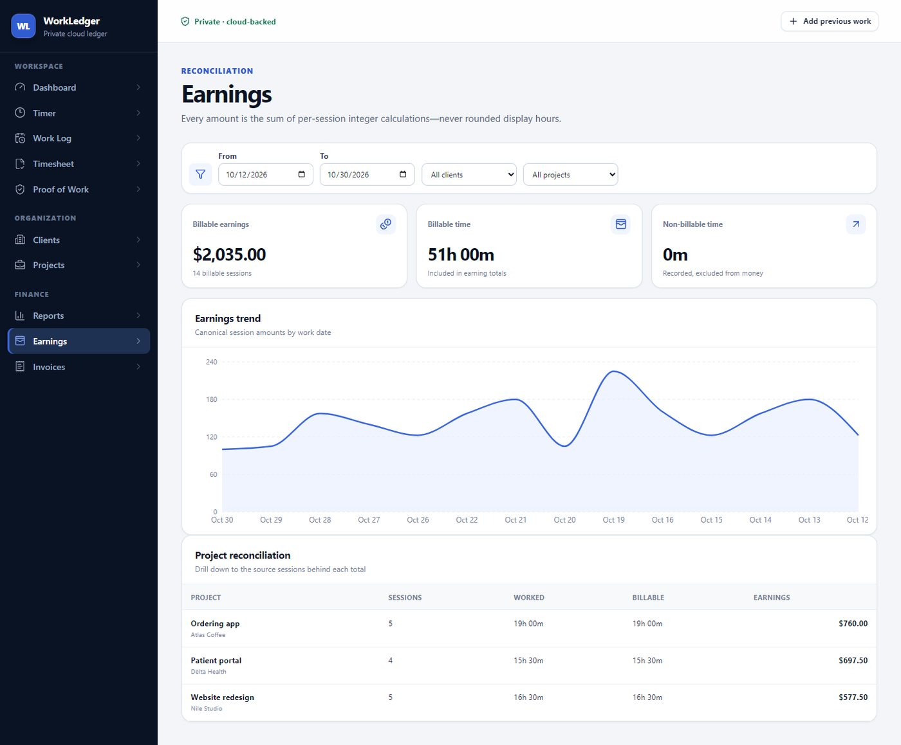
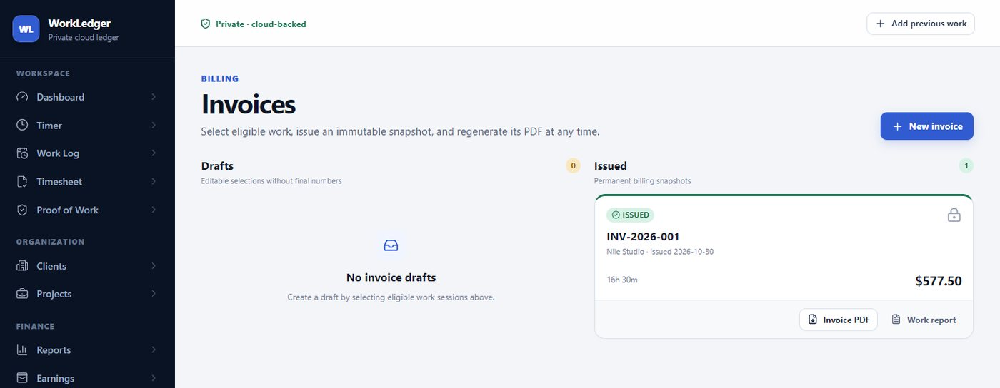

# WorkLedger

[](https://github.com/ramezGamel01/workledger/actions/workflows/ci.yml)

WorkLedger is a private cloud-backed work tracking application for hourly contractors. It records live and historical work, keeps proof of work beside the time it supports, calculates earnings, and produces professional invoices and work-activity reports.

**[Try the live demo](https://ramezgamel01.github.io/workledger/)** with sample data (nothing leaves your browser) · [Read the case study](https://ramezgamel.vercel.app/case-workledger.html)

<picture>
  <source media="(prefers-color-scheme: dark)" srcset="docs/screenshots/dashboard-dark.jpg">
  
</picture>

| Timesheet                                    | Earnings                                   | Invoices                                   |
| -------------------------------------------- | ------------------------------------------ | ------------------------------------------ |
|  |  |  |

## Current state

**WorkLedger V1.1.1 adds safer organization controls to the cloud-backed V1 product.**

The application covers the full workflow: freelancer setup,
clients, projects and tasks, historical entry, a resilient live timer, proof of
work, logs and timesheets, earnings analysis, immutable invoices, invoice and
work-report PDFs, read-only audit history, plus validated ZIP backup and atomic
restore. D1 now persists structured records across devices, R2 persists evidence
files, and IndexedDB remains the fast local cache and pending-write safety layer.

Formatting, linting, strict type checking, 18 deterministic tests and the
server-backed production build run in CI on every push. A Playwright smoke
test for the first-run workflow is included (`pnpm test:e2e`).

The Phase 0 baseline is defined by:

- [`docs/PRODUCT.md`](docs/PRODUCT.md) — users, outcomes, scope, and workflows.
- [`docs/ARCHITECTURE.md`](docs/ARCHITECTURE.md) — boundaries, layers, storage, and quality strategy.
- [`docs/DATA_MODEL.md`](docs/DATA_MODEL.md) — entities, fields, relationships, indexes, and invariants.
- [`docs/BUSINESS_RULES.md`](docs/BUSINESS_RULES.md) — canonical time, money, evidence, invoice, and backup rules.
- [`docs/ROADMAP.md`](docs/ROADMAP.md) — phased delivery plan and acceptance gates.
- [`docs/DECISIONS.md`](docs/DECISIONS.md) — accepted architectural decision records.

## Product flow

```text
Freelancer Profile
        ↓
Client → Project → Work Session → Evidence
                         ↓
          Work Log / Timesheet / Earnings
                         ↓
                Invoice / Work Report
```

## Technology baseline

- React, TypeScript, Vite, and Vinext
- React Router
- Dexie over IndexedDB for the local working cache
- D1 for versioned structured cloud snapshots
- R2 for private evidence files
- Private Site authentication headers for owner isolation
- Zustand for transient application state only
- React Hook Form and Zod
- date-fns, with one approved timezone adapter if implementation proves it necessary
- Recharts
- `@react-pdf/renderer`
- Vitest, React Testing Library, and Playwright
- ESLint and Prettier

## Privacy and continuity

- Records and evidence synchronize to owner-scoped private cloud storage and
  remain cached in browser IndexedDB.
- WorkLedger has no public signup, team roles, analytics, telemetry, or remote
  application logging.
- Existing data from the stable production origin migrates automatically when
  the cloud ledger is empty.
- Export a complete ZIP from **Settings → Backup & restore** as an additional
  portable recovery copy and before resolving a reported version conflict.
- Restoring a backup validates versions, references, paths, and checksums before
  replacing the current local dataset atomically, then synchronizes the restored
  state to cloud.

## Development

```bash
pnpm install
pnpm dev
```

The public demo is a static build of the same app: sample data is seeded in the
browser, cloud sync is off, and a Reset button restores the sample data. The
Demo workflow publishes it to GitHub Pages on every push to `main`.

```bash
pnpm dev:demo     # demo with hot reload
pnpm build:demo   # static build in dist-demo/
```

Quality gates:

```bash
pnpm format:check
pnpm lint
pnpm typecheck
pnpm test
pnpm build
pnpm test:e2e
```

Install the Playwright browser once on a browser-enabled development machine:

```bash
pnpm exec playwright install chromium
```

## Release record

See [`docs/RELEASE_NOTES.md`](docs/RELEASE_NOTES.md) for the V1 feature,
storage, compatibility, and verification summary.
