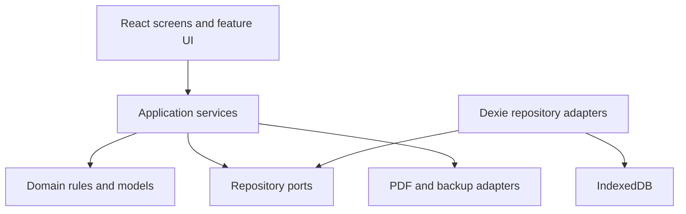
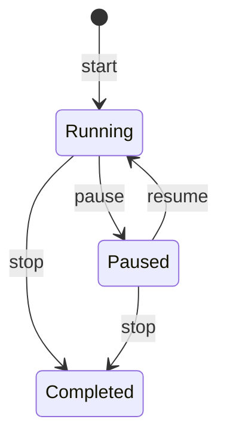

# WorkLedger architecture

- **Document status:** Accepted Phase 0 baseline
- **Architecture version:** 0.1.0
- **Last updated:** 2026-09-20

## 1. Context

WorkLedger is a local-first, single-user web application that stores time records, billing data, and potentially confidential proof-of-work files. V1 has no application backend. The browser is the runtime and IndexedDB is the authoritative store.

The architecture must make a future API-backed version possible without forcing the V1 UI to understand storage details.

## 2. Architectural goals

1. Preserve time, money, and evidence accurately across reloads and version upgrades.
2. Keep business rules centralized, pure where practical, and straightforward to test.
3. Prevent UI components from depending on a specific persistence engine.
4. Treat audit writes and the business mutation they describe as one operation.
5. Recover a running timer deterministically from persisted timestamps.
6. Generate every view and document from canonical records or frozen snapshots.
7. Contain failures so evidence, PDF, or chart errors do not corrupt work sessions.
8. Support a future backend by replacing repository implementations rather than rewriting domain behavior.

## 3. Constraints

- One local owner; no authentication or authorization model in V1.
- Static web application deployed on a stable HTTPS origin.
- Browser storage quotas and eviction policies vary by browser and device.
- IndexedDB is durable browser storage, but it is not a guaranteed backup.
- The application may be open in several tabs at once.
- Confidential evidence must not leave the device through product behavior.
- Browser and operating-system storage encryption are outside the application's control.

## 4. Technology baseline

| Concern              | Approved choice                | Purpose                                              |
| -------------------- | ------------------------------ | ---------------------------------------------------- |
| UI runtime           | React + TypeScript             | Component model and type-safe feature code           |
| Build                | Vite                           | Fast static application build                        |
| Routing              | React Router                   | Multi-screen client-side navigation                  |
| Local database       | Dexie + IndexedDB              | Structured records, indexes, transactions, and blobs |
| Transient state      | Zustand                        | UI coordination and active timer presentation only   |
| Forms                | React Hook Form + Zod          | Input state plus shared validation schemas           |
| Dates                | date-fns                       | Formatting and date arithmetic                       |
| Charts               | Recharts                       | Activity and earnings visualizations                 |
| PDF                  | `@react-pdf/renderer`          | Deterministic invoice and report PDFs                |
| Unit/component tests | Vitest + React Testing Library | Pure logic and UI behavior                           |
| End-to-end tests     | Playwright                     | Critical user journeys                               |
| Quality              | ESLint + Prettier + TypeScript | Static quality gates                                 |

One timezone helper compatible with `date-fns` may be approved in Phase 1 if native `Intl` is insufficient for the documented midnight and IANA-timezone rules. A ZIP implementation may be approved in the backup phase after comparing browser support, bundle size, streaming behavior, and maintenance status. Neither choice changes the domain model.

## 5. System shape



Dependency direction is inward:

- Domain code imports no React, Dexie, browser storage, chart, or PDF code.
- Application services depend on domain code and repository interfaces.
- Infrastructure adapters implement interfaces and may depend on Dexie or browser APIs.
- Features depend on application services and shared UI primitives, not infrastructure internals.

## 6. Layers and responsibilities

### 6.1 Domain

Contains:

- Entity and value-object types.
- State-transition rules.
- Duration, billing, rounding, and invoice eligibility rules.
- Validation that does not require I/O.
- Pure selectors and aggregations.

Domain code accepts explicit clocks, identifiers, timezones, and locale inputs when behavior depends on them. It never reads the current time or browser locale implicitly.

### 6.2 Application services

Application services implement use cases and own transaction boundaries, including:

- Create/update/archive client and project.
- Add historical work.
- Start/pause/resume/stop timer.
- Attach/remove evidence.
- Create and issue invoice.
- Export, validate, preview, and restore backup.

A service coordinates repositories, validates cross-entity rules, and records audit events. Services return typed results or typed application errors; they do not return raw Dexie exceptions.

### 6.3 Repository ports

Repository interfaces describe the persistence operations the application layer needs. Interfaces are shaped around use cases, not around components or database tables.

Examples:

- `ClientRepository`
- `ProjectRepository`
- `WorkSessionRepository`
- `EvidenceRepository`
- `InvoiceRepository`
- `AuditRepository`
- `SettingsRepository`
- `TransactionCoordinator`

### 6.4 Infrastructure

Infrastructure contains:

- Dexie database and version declarations.
- Repository adapters.
- Browser lock and cross-tab messaging adapters.
- Blob URL and file handling.
- PDF rendering adapters.
- ZIP/checksum backup adapters.
- Download and browser capability adapters.

Infrastructure errors are translated into stable application error codes.

### 6.5 Features and UI

Feature folders own routes, screens, forms, feature-specific components, view models, and query hooks. Shared controls live in `components/ui`; shared layout lives in `components/layout`.

UI responsibilities are limited to:

- Collecting input.
- Presenting query results and derived view models.
- Calling application commands.
- Showing validation, loading, empty, success, and failure states.

The UI never computes a second version of billable time or money.

## 7. Proposed repository structure

```text
workledger/
├── AGENTS.md
├── CODEX.md
├── README.md
├── docs/
│   ├── PRODUCT.md
│   ├── ARCHITECTURE.md
│   ├── DATA_MODEL.md
│   ├── BUSINESS_RULES.md
│   ├── ROADMAP.md
│   └── DECISIONS.md
├── src/
│   ├── app/
│   │   ├── App.tsx
│   │   ├── router.tsx
│   │   └── providers.tsx
│   ├── components/
│   │   ├── layout/
│   │   └── ui/
│   ├── domain/
│   │   ├── models/
│   │   ├── rules/
│   │   ├── types/
│   │   └── value-objects/
│   ├── services/
│   │   ├── ports/
│   │   ├── clients/
│   │   ├── projects/
│   │   ├── sessions/
│   │   ├── evidence/
│   │   ├── billing/
│   │   ├── invoices/
│   │   └── backup/
│   ├── db/
│   │   ├── database.ts
│   │   ├── schema.ts
│   │   ├── migrations/
│   │   └── repositories/
│   ├── features/
│   │   ├── dashboard/
│   │   ├── tracker/
│   │   ├── sessions/
│   │   ├── evidence/
│   │   ├── timesheet/
│   │   ├── clients/
│   │   ├── projects/
│   │   ├── reports/
│   │   ├── earnings/
│   │   ├── invoices/
│   │   └── settings/
│   ├── hooks/
│   ├── lib/
│   ├── styles/
│   └── test/
├── e2e/
├── public/
└── package.json
```

The exact test colocation pattern is selected in Phase 1, but behavior tests remain near the code they verify and broad journeys remain in `e2e/`.

## 8. Runtime data flows

### 8.1 Query flow

```text
Screen
  → feature query hook
  → application query service
  → repository port
  → Dexie adapter
  → view model / domain selector
  → rendered state
```

Dexie subscriptions may exist inside infrastructure-backed query hooks, but a screen must not import the database instance or table objects.

### 8.2 Mutation flow

```text
Form or control
  → parse and validate input
  → application command
  → domain validation
  → database transaction
       ├── write business record(s)
       └── append audit event(s)
  → typed result
  → user feedback
```

### 8.3 Evidence flow

Session creation and evidence persistence are separate commands by design:

1. Save the work session.
2. Attempt each evidence item.
3. Report item-level results.
4. Preserve the session even if one or more evidence items fail.

Within one evidence command, metadata and its blob commit atomically as one `EvidenceAsset` record.

## 9. State ownership

### IndexedDB is authoritative for

- Freelancer profile and settings.
- Clients, projects, and tasks.
- Sessions and segments.
- Evidence metadata and blobs.
- Audit events.
- Invoices, invoice lines, and invoice-session links.

### Zustand may hold

- Sidebar and dialog state.
- Unsaved filters.
- Current form/UI selections.
- A presentation snapshot of the persisted active timer.
- Toast and transient workflow state.

Zustand must not be the sole owner of an active timer or a completed business record.

### `localStorage` may hold

- Theme preference when introduced.
- Non-sensitive UI preferences.
- A last-known app version hint.

Business data, evidence, rates, and invoice contents do not belong in `localStorage`.

## 10. Database design and migrations

### 10.1 Database

- Database name: `workledger`.
- Schema begins at Dexie version 1.
- Stable identifiers are generated with `crypto.randomUUID()`.
- Records use explicit timestamps rather than implicit Dexie metadata.
- Fields required for filtering are indexed; large JSON or blob content is not indexed.

### 10.2 Initial logical tables

```text
freelancerProfiles
appSettings
clients
projects
tasks
workSessions
sessionSegments
evidenceAssets
auditEvents
invoices
invoiceLines
invoiceSessionLinks
invoiceSequences
```

Physical index definitions are finalized in Phase 3 using the query inventory in `DATA_MODEL.md`.

### 10.3 Migration policy

- Every schema change creates a new monotonically increasing Dexie version.
- A migration is forward-only and idempotent for each record it transforms.
- Migration code validates assumptions and fails without deleting data.
- Every non-trivial migration has tests using a database created at the prior version.
- Old migrations remain in source control.
- Destructive field removal requires an earlier release that stops reading the field and a documented compatibility decision.

## 11. Timer architecture

### 11.1 Canonical elapsed time

The screen may update once per second, but the timer does not persist ticks. Canonical elapsed duration is calculated from persisted session segments plus the current time for one open segment.

This prevents interval throttling, sleep, tab suspension, and page reload from losing elapsed time.

### 11.2 Command state machine



Every command is idempotent at the service boundary where practical. Duplicate UI clicks must not create duplicate segments or sessions.

### 11.3 Cross-tab coordination

- Use the Web Locks API when available to serialize timer mutations.
- Use `BroadcastChannel` to notify other tabs after timer state changes.
- Retain a database-level invariant check inside the transaction; browser locks are not the only protection.
- If Web Locks is unavailable, use a short-lived IndexedDB lease plus transaction validation.
- A losing tab refreshes its state and explains that the timer changed elsewhere.

## 12. Date and timezone architecture

- Instants are stored as UTC ISO 8601 strings.
- A work date is stored separately as `YYYY-MM-DD` in the session's `timeZone`.
- Project and session timezones use valid IANA identifiers.
- Session aggregation uses persisted `workDate`; it does not recompute history in the device's new timezone.
- The active timer is partitioned at local midnight according to the session timezone. If the browser was suspended, partitioning occurs deterministically on recovery or the next timer action.
- Formatting is a presentation concern and uses the user's current locale settings.

## 13. Money architecture

- Rates and totals are integer minor units.
- Currency is an ISO 4217 code and is never inferred solely from a symbol.
- A currency metadata utility defines fraction digits for formatting and validation.
- `BillingService` owns session amount and invoice total calculations.
- The invoice engine consumes frozen session/rate data; components do not multiply display values.
- V1 performs no foreign-exchange conversion.

## 14. Invoice and document architecture

### Draft invoice

A draft references selected sessions and may be rebuilt from current eligible data. Draft edits never mutate the source sessions.

### Issue transaction

Issuing an invoice performs one transaction that:

1. Revalidates session eligibility.
2. Allocates the next invoice number.
3. Writes all invoice snapshots and lines.
4. Writes invoice-session links.
5. Marks the invoice issued.
6. Appends audit events.

### PDF rendering

- PDFs render from a dedicated document view model.
- Issued invoice PDFs render only from invoice snapshots.
- Work reports render from a query snapshot captured at generation time.
- Blob/image decoding errors produce an evidence omission warning; they do not change source records.
- Document generation has no network dependency.

## 15. Backup architecture

A backup adapter serializes logical records independently from Dexie's internal representation. The ZIP contains:

```text
manifest.json
data.json
evidence/<evidence-id>.<extension>
```

`manifest.json` contains the backup format version, database schema version, product version, creation timestamp, record counts, and SHA-256 checksums.

Restore uses four explicit stages:

```text
Parse → Validate → Preview → Confirm and replace
```

The initial V1 restore mode is full replacement only. Merge restore is deferred because reconciling identifiers, invoices, audit history, and evidence safely is a separate product feature.

## 16. Error model

Application errors use stable codes and safe messages. Initial categories include:

- `VALIDATION_ERROR`
- `NOT_FOUND`
- `CONFLICT`
- `TIMER_STATE_CONFLICT`
- `OVERLAPPING_SESSION`
- `INVOICE_INELIGIBLE`
- `STORAGE_QUOTA_EXCEEDED`
- `UNSUPPORTED_FILE`
- `BACKUP_INVALID`
- `BACKUP_VERSION_UNSUPPORTED`
- `PDF_GENERATION_FAILED`
- `PERSISTENCE_FAILED`

Raw storage exceptions may be retained as a non-sensitive `cause` for development but are not shown verbatim to users.

## 17. Privacy and security

- No analytics, advertising, remote logging, or telemetry in V1.
- No evidence or backup upload from product code.
- Prefer bundled or system fonts and icons so ordinary use has no external asset requests.
- Use a restrictive Content Security Policy compatible with the selected build.
- Sanitize filenames for downloads and never execute uploaded content.
- Evidence links allow only `http:` and `https:` schemes.
- Revoke temporary object URLs when previews unmount.
- Spreadsheet-formula injection protections apply if CSV export is added later.
- The UI explicitly explains that anyone with access to the browser profile or exported backup may access the data.

## 18. Performance and storage

- Query indexed date ranges; do not load all sessions for routine dashboards.
- Paginate or virtualize long logs when measured data shows it is needed.
- Lazy-load report and PDF generation code.
- Generate thumbnails for large images and keep the original blob for report export.
- Use `navigator.storage.estimate()` when available and show usage/warnings in Settings.
- Request persistent browser storage when supported, but never describe it as a backup guarantee.
- Avoid holding full backup archives and all evidence previews in memory simultaneously when a streaming option is available.

## 19. Testing architecture

### Unit tests

- State transitions.
- Segment duration and midnight partitioning.
- Manual range and duration calculations.
- Money rounding and aggregation.
- Invoice eligibility and totals.
- Validation schemas.
- Backup manifest validation.

### Repository integration tests

- CRUD and indexes.
- Atomic business mutation plus audit event.
- Active timer uniqueness.
- Invoice issue transaction and duplicate-billing protection.
- Evidence blob persistence.
- Database migrations.
- Atomic restore behavior.

### Component tests

- Form validation and error focus.
- Keyboard interaction.
- Loading, empty, partial failure, and conflict states.
- Responsive component adaptations where behavior changes.

### End-to-end tests

- First-run profile/client/project setup.
- Historical range and duration entry.
- Start, pause, reload, resume, and stop timer.
- Evidence upload failure without session loss.
- Timesheet and earnings reconciliation.
- Issue invoice and generate PDFs.
- Backup, reset in an isolated test profile, and restore.

Tests use deterministic clocks, IDs, locale, and timezone fixtures.

## 20. Build and deployment

- V1 builds to static assets.
- The deployed origin must remain stable because IndexedDB is origin-scoped.
- Production uses HTTPS.
- Build output contains no credentials or private sample data.
- Release notes call out schema migrations and backup format changes.
- Deployment is not a durability mechanism; users are prompted to keep backups.

## 21. Evolution boundary for V2

A server-backed V2 may introduce authentication, PostgreSQL, object storage, and synchronization. The intended replacement boundary is the repository and infrastructure layer.

V2 still requires explicit decisions for conflict resolution, tenant isolation, encryption, retention, access control, upload security, and migration of local V1 data. No V1 code should pretend those decisions already exist.
