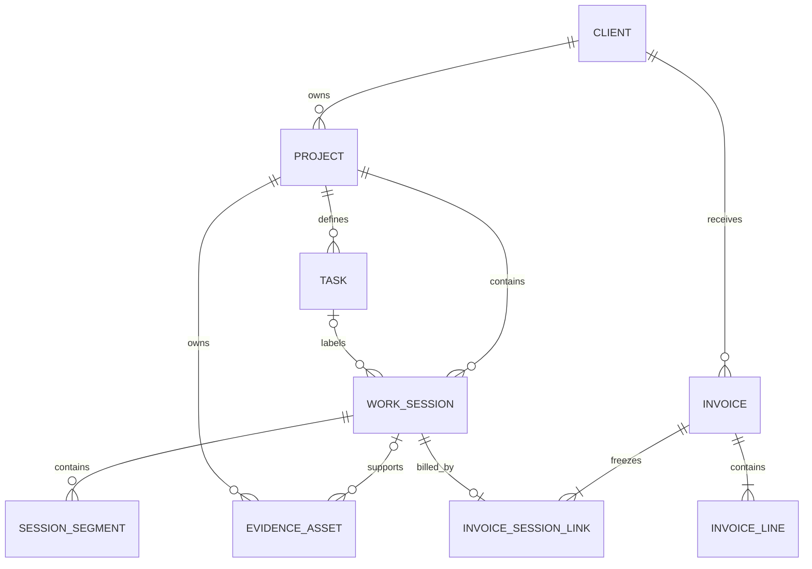

# WorkLedger data model

- **Document status:** Accepted Phase 0 baseline
- **Model version:** 1.1.0
- **Last updated:** 2026-09-21

## 1. Modeling conventions

### Identifiers

- Entity identifiers are opaque UUID strings generated with `crypto.randomUUID()`.
- Identifiers are never derived from names, dates, array positions, or invoice display numbers.
- Backup import preserves identifiers after validating uniqueness and references.

### Time

- Persisted instants use UTC ISO 8601 strings, for example `2026-09-20T18:42:10.000Z`.
- Calendar dates use `YYYY-MM-DD`.
- IANA timezone identifiers are stored explicitly where a date is derived from an instant.
- Durations use non-negative integer seconds.

### Money

- Monetary values use integer minor units, such as `1500` for USD 15.00.
- Currency uses an uppercase ISO 4217 code.
- A money value is never valid without its currency context.

### Mutable records

Mutable aggregate roots have:

```ts
type MutableRecord = {
  id: string;
  version: number;
  createdAt: string;
  updatedAt: string;
};
```

`version` increments after every successful mutation and supports multi-tab conflict detection.

### Optionality

- A missing value is stored as `null` when absence is meaningful in persisted data.
- `undefined` is not used as an intentional persisted value.
- Required text is trimmed and must contain at least one non-whitespace character.

## 2. Enumerations

```ts
type RecordStatus = "active" | "archived";

type WorkSessionSource = "tracked" | "manual_range" | "manual_duration";

type WorkSessionStatus = "running" | "paused" | "completed";

type SessionDetailStatus = "complete" | "incomplete";

type EvidenceScope = "session" | "day";
type EvidenceKind = "screenshot" | "file" | "link";

type InvoiceStatus = "draft" | "issued";

type AuditActor = "local_user" | "system" | "restore";
```

Enum values are persisted lowercase. Interface badges may display user-friendly uppercase labels.

## 3. Entity overview



Audit events can reference any business entity and are intentionally omitted from the relationship diagram for readability.

## 4. FreelancerProfile

There is exactly one V1 profile with the stable identifier `owner`.

```ts
type FreelancerProfile = MutableRecord & {
  id: "owner";
  displayName: string;
  legalName: string | null;
  email: string;
  phone: string | null;
  address: PostalAddress | null;
  taxIdentifier: string | null;
  paymentDetails: PaymentDetails | null;
};
```

```ts
type PostalAddress = {
  line1: string;
  line2: string | null;
  city: string;
  region: string | null;
  postalCode: string | null;
  countryCode: string;
};

type PaymentDetails = {
  accountName: string | null;
  bankName: string | null;
  accountReference: string | null;
  swiftBic: string | null;
  paymentInstructions: string | null;
};
```

### Invariants

- `displayName` and `email` are required before an invoice can be issued.
- Country uses an ISO 3166-1 alpha-2 code when an address is present.
- Payment details are copied into an issued invoice snapshot; later profile edits do not modify issued invoices.

## 5. AppSettings

There is exactly one record with the stable identifier `settings`.

```ts
type AppSettings = MutableRecord & {
  id: "settings";
  locale: string;
  defaultTimeZone: string;
  defaultCurrency: string;
  weekStartsOn: 0 | 1 | 6;
  hourCycle: "h12" | "h23";
  invoicePrefix: string;
  defaultPaymentTermsDays: number | null;
};
```

### Invariants

- `locale` is a valid BCP 47 language tag.
- `defaultTimeZone` is a supported IANA timezone.
- `defaultCurrency` is a supported ISO 4217 code.
- `invoicePrefix` contains only uppercase letters, digits, and hyphens and is 1–12 characters.
- Settings affect defaults and formatting; they do not rewrite historical records.

## 6. Client

```ts
type Client = MutableRecord & {
  displayName: string;
  legalName: string | null;
  companyName: string | null;
  email: string | null;
  phone: string | null;
  billingAddress: PostalAddress | null;
  taxIdentifier: string | null;
  defaultCurrency: string;
  invoiceNotes: string | null;
  status: RecordStatus;
  archivedAt: string | null;
};
```

### Invariants

- `displayName` is required and unique after case/whitespace normalization among active clients.
- Archiving a client does not archive its projects automatically.
- A client referenced by work or an invoice is never hard-deleted in V1.

## 7. Project

```ts
type Project = MutableRecord & {
  clientId: string;
  name: string;
  description: string | null;
  startDate: string | null;
  endDate: string | null;
  hourlyRateMinor: number;
  currency: string;
  timeZone: string;
  colorToken: string | null;
  status: RecordStatus;
  archivedAt: string | null;
};
```

### Invariants

- The referenced client exists.
- Project name is unique after normalization within one client among active projects.
- `hourlyRateMinor` is a safe, non-negative integer.
- `currency` is an ISO 4217 code.
- `timeZone` is a valid IANA timezone.
- If both dates exist, `endDate >= startDate`.
- Changing the rate, currency, timezone, or name does not rewrite existing session snapshots.
- Archived projects cannot start a new timer or receive new manual work unless restored first.

## 8. Task

```ts
type Task = MutableRecord & {
  projectId: string;
  name: string;
  description: string | null;
  status: RecordStatus;
  archivedAt: string | null;
};
```

### Invariants

- The referenced project exists.
- Task name is unique after normalization within one project among active tasks.
- Archived tasks remain resolvable from historical sessions but cannot be selected for new work.

## 9. WorkSession

`WorkSession` is the central product entity.

```ts
type WorkSession = MutableRecord & {
  projectId: string;
  taskId: string | null;
  taskNameSnapshot: string | null;

  source: WorkSessionSource;
  status: WorkSessionStatus;
  detailStatus: SessionDetailStatus;

  workDate: string;
  timeZone: string;
  startedAt: string | null;
  endedAt: string | null;

  durationSeconds: number;
  breakSeconds: number;

  description: string | null;
  billable: boolean;
  hourlyRateMinorSnapshot: number;
  currencySnapshot: string;

  continuationGroupId: string | null;
  finalizedAt: string | null;

  deletedAt: string | null;
  deletedReason: string | null;
};
```

### Source-specific meaning

#### `tracked`

- Has one or more `SessionSegment` records.
- `durationSeconds` is a cached projection of closed segments and is revalidated when mutated.
- `startedAt` is the earliest segment start.
- `endedAt` is null until completed, then equals the latest closed segment end.
- `breakSeconds` is derived from gaps for presentation and is not subtracted a second time.

#### `manual_range`

- Has no segments.
- Requires `startedAt` and `endedAt`.
- `durationSeconds = wallClockSeconds - breakSeconds` under the canonical timezone rules.
- `breakSeconds` is user supplied and less than wall-clock duration.

#### `manual_duration`

- Has no segments.
- `startedAt` and `endedAt` are null.
- `durationSeconds` is entered directly at whole-minute granularity.
- `breakSeconds` is zero.

### General invariants

- Project exists and task, if present, belongs to that project.
- `workDate` is interpreted in `timeZone` and does not change when device timezone changes.
- `durationSeconds` and `breakSeconds` are safe, non-negative integers.
- Completed sessions have positive duration and non-null `finalizedAt`.
- Running and paused states are valid only for `tracked` sessions.
- Manual sessions are created as `completed`.
- A quick historical row may be `detailStatus = incomplete` with no description; it is excluded from invoicing until completed.
- A complete session requires a non-empty description.
- Rate and currency snapshots are captured at session creation and changed only by an explicit audited edit.
- Non-billable sessions retain rate/currency snapshots but contribute zero billing amount.
- Deleted sessions are excluded from ordinary queries and cannot be invoiced.
- A session linked to an issued invoice cannot be edited or deleted.
- `source` never changes after creation.

## 10. SessionSegment

```ts
type SessionSegment = {
  id: string;
  sessionId: string;
  sequence: number;
  startedAt: string;
  endedAt: string | null;
  createdAt: string;
  updatedAt: string;
};
```

### Invariants

- The parent session exists and has `source = tracked`.
- Sequence is a positive integer unique within the session.
- Segment ranges do not overlap within a session.
- `endedAt`, when present, is strictly later than `startedAt`.
- A running session has exactly one open segment and it is the highest sequence.
- A paused or completed session has no open segment.
- Closed segment timestamps may be corrected only through an audited completed-session edit.

## 11. EvidenceAsset

```ts
type EvidenceAsset = MutableRecord & {
  projectId: string;
  scope: EvidenceScope;
  sessionId: string | null;
  workDate: string | null;

  kind: EvidenceKind;
  originalName: string | null;
  mimeType: string | null;
  sizeBytes: number | null;
  blob: Blob | null;
  thumbnailBlob: Blob | null;
  url: string | null;
  sha256: string | null;

  caption: string | null;
  capturedAt: string | null;
  uploadedAt: string;
  deletedAt: string | null;
};
```

### Scope invariants

| Scope     | `sessionId` | `workDate` |
| --------- | ----------: | ---------: |
| `session` |    required |       null |
| `day`     |        null |   required |

For session scope, the parent session belongs to `projectId`. For day scope, `workDate` uses the project's timezone at creation.

### Kind invariants

| Kind         |     Blob |      URL | File metadata |
| ------------ | -------: | -------: | ------------: |
| `screenshot` | required |     null |      required |
| `file`       | required |     null |      required |
| `link`       |     null | required |          null |

Additional rules:

- Links use only `http:` or `https:`.
- `sizeBytes` equals the original blob size.
- `sha256` covers the original blob bytes.
- A thumbnail is derived and disposable; the original blob is authoritative.
- Deleting evidence is soft deletion in V1 and is audited.
- Evidence for a session linked to an issued invoice remains editable because the invoice PDF does not embed live evidence; an invoice-based work report uses its own generation snapshot.

## 12. AuditEvent

```ts
type AuditEvent = {
  id: string;
  operationId: string;
  entityType: string;
  entityId: string;
  action: string;
  actor: AuditActor;
  before: Record<string, unknown> | null;
  after: Record<string, unknown> | null;
  changedFields: string[];
  reason: string | null;
  createdAt: string;
};
```

### Invariants

- Audit events are append-only and never edited or deleted by product behavior.
- Events contain only the business fields required to explain a change.
- Blobs, thumbnails, full backup contents, and redundant large payloads are excluded.
- Related events from one transaction share `operationId`.
- Creation, material update, archive/delete, restore, invoice issue, and backup restore actions are audited.

## 13. InvoiceSequence

```ts
type InvoiceSequence = MutableRecord & {
  key: string;
  prefix: string;
  year: number;
  nextValue: number;
};
```

### Invariants

- `key` is the normalized combination of prefix and year.
- `nextValue` is a positive safe integer.
- The value is allocated and incremented inside the invoice issue transaction.
- Deleting drafts does not consume a number because drafts have no final invoice number.

## 14. Invoice

```ts
type Invoice = MutableRecord & {
  status: InvoiceStatus;
  invoiceNumber: string | null;

  clientId: string;
  currency: string;
  periodStart: string;
  periodEnd: string;
  issueDate: string | null;
  dueDate: string | null;

  freelancerSnapshot: FreelancerInvoiceSnapshot | null;
  clientSnapshot: ClientInvoiceSnapshot | null;
  paymentSnapshot: PaymentDetails | null;

  totalSeconds: number;
  subtotalMinor: number;
  totalMinor: number;

  notes: string | null;
  issuedAt: string | null;
};
```

```ts
type FreelancerInvoiceSnapshot = {
  displayName: string;
  legalName: string | null;
  email: string;
  phone: string | null;
  address: PostalAddress | null;
  taxIdentifier: string | null;
};

type ClientInvoiceSnapshot = {
  displayName: string;
  legalName: string | null;
  companyName: string | null;
  email: string | null;
  billingAddress: PostalAddress | null;
  taxIdentifier: string | null;
};
```

### Invariants

- `periodEnd >= periodStart`.
- One invoice contains sessions for exactly one client and one currency.
- Draft invoices have null final snapshots, `invoiceNumber`, `issueDate`, and `issuedAt`; their totals are recalculable.
- Issued invoices have complete snapshots, a unique invoice number, non-null dates, and frozen totals.
- `totalMinor = subtotalMinor` in V1 because tax, discount, and fees are out of scope.
- Issued invoices are immutable.

## 15. InvoiceLine

```ts
type InvoiceLine = {
  id: string;
  invoiceId: string;
  ordinal: number;
  projectId: string;
  projectNameSnapshot: string;
  periodStart: string;
  periodEnd: string;
  description: string;
  durationSeconds: number;
  hourlyRateMinor: number;
  currency: string;
  amountMinor: number;
  createdAt: string;
};
```

### Invariants

- Ordinal is unique within an invoice and determines display order.
- Lines group sessions by project, rate, currency, and configured week boundary.
- A rate change creates a separate line.
- Line amounts equal the sum of their frozen linked-session amounts; they are not independently editable.
- Issued invoice lines are immutable.

## 16. InvoiceSessionLink

```ts
type InvoiceSessionLink = {
  id: string;
  invoiceId: string;
  invoiceLineId: string | null;
  sessionId: string;
  sessionSnapshot: SessionBillingSnapshot | null;
  createdAt: string;
};

type SessionBillingSnapshot = {
  workDate: string;
  projectId: string;
  projectName: string;
  taskName: string | null;
  description: string;
  durationSeconds: number;
  hourlyRateMinor: number;
  currency: string;
  amountMinor: number;
};
```

### Invariants

- `sessionId` is globally unique in this table; a session belongs to at most one draft or issued invoice.
- The linked session is completed, complete, billable, not deleted, and belongs to the invoice client/currency/period.
- Draft links may have null line and snapshot values while the draft is being edited.
- Issue populates every line and session snapshot atomically.
- Issued links are immutable.
- Deleting a draft deletes its links and releases its sessions.

## 17. Derived models that are not stored

The following are projections, not independent entities:

- Dashboard totals.
- Daily/weekly/monthly summaries.
- Timesheet rows and totals.
- Earnings summaries.
- Active timer elapsed display.
- Project distribution.
- Evidence counts.
- Work report view models.
- Invoice eligibility lists.

They are recalculated from canonical records or issued snapshots.

## 18. Relationship and lifecycle rules

### Archiving

- Clients, projects, and tasks are archived rather than deleted once referenced.
- Archiving hides them from new-work selectors but preserves history.
- A referenced parent remains readable even if archived.

### Session deletion

- Eligible sessions use soft deletion.
- Their segments and evidence remain stored and hidden with the session so restore is possible.
- Sessions linked to an issued invoice cannot be deleted.
- A session linked only to a draft must first be removed from that draft.

### Draft deletion

- Draft invoice, lines, and links may be deleted together.
- Source sessions are not modified.

### Issued records

- Issued invoices, lines, and links have no delete or update workflow in V1.
- Corrections are handled by preserving the issued record and creating a new document outside V1's automated credit-note scope.

## 19. Initial query inventory and indexes

Final Dexie syntax is set in Phase 3. The schema must efficiently support:

| Query                      | Required index shape                                          |
| -------------------------- | ------------------------------------------------------------- |
| Active clients             | client status + normalized name                               |
| Projects for client        | client ID + status                                            |
| Tasks for project          | project ID + status                                           |
| Session date range         | work date                                                     |
| Sessions for project/date  | project ID + work date                                        |
| Active timer               | session status + source                                       |
| Visible sessions           | deleted state + work date                                     |
| Segments in order          | session ID + sequence                                         |
| Session evidence           | session ID + deleted state                                    |
| Daily evidence             | project ID + work date + scope                                |
| Entity history             | entity type + entity ID + created time                        |
| Invoices for client        | client ID + status + period                                   |
| Invoice lines              | invoice ID + ordinal                                          |
| Sessions already allocated | unique session ID on invoice-session link                     |
| Invoice number             | unique invoice number when present, validated transactionally |

Normalized search keys may be persisted as explicit derived fields if Dexie query requirements demand them. They are implementation details and must be regenerated consistently in migrations.

## 20. Cross-entity invariants

| Invariant                                     | Enforcement boundary                          |
| --------------------------------------------- | --------------------------------------------- |
| At most one running or paused session         | Timer service transaction plus cross-tab lock |
| At most one open segment globally             | Timer service transaction                     |
| One session belongs to at most one invoice    | Unique link plus issue revalidation           |
| Time/money mutation has audit event           | Same Dexie transaction                        |
| Invoice contains one client/currency          | Draft validation and issue transaction        |
| Evidence scope references exactly one target  | Schema validation and repository guard        |
| Archived parent remains historically readable | No hard deletion of referenced parents        |
| Issued invoice graph is immutable             | Service API and repository guard              |
| Backup references are internally valid        | Import validation before restore              |

## 21. Backup representation

The backup format is a portable representation, not a raw IndexedDB dump.

- Entity records are stored in `data.json` without inline blobs.
- Evidence records refer to relative files under `evidence/`.
- Dates, integers, nulls, and enum values retain their documented semantics.
- Manifest record counts and checksums must match the archive.
- Unknown optional fields may be retained for forward compatibility; unknown required versions are rejected.

The backup format has its own version separate from the Dexie schema version.

## 22. Cloud persistence representation

The cloud layer does not introduce a second set of business entities. It stores
a versioned serialization of the same `LedgerSnapshot` used by the local
application, with evidence blobs removed from structured JSON.

- `ledger_versions` identifies one owner-scoped snapshot version, its chunk
  count, UTF-8 byte length, account email, and update time.
- `ledger_snapshot_chunks` stores ordered bounded text chunks keyed by owner,
  version, and chunk index. The composite key makes competing writes to the
  same next version conflict rather than overwrite silently.
- The five most recent structured versions are retained for operational
  recovery; the latest complete version is authoritative across devices.
- Binary evidence is stored in R2 at `<authenticated-user-id>/<evidence-id>`.
- IndexedDB retains the hydrated business records and evidence blobs as the
  local working cache. It is replaced atomically after a complete cloud load.
- Evidence metadata and checksum stay in the structured snapshot. Blob bytes
  never enter D1 JSON, audit events, `localStorage`, or logs.
